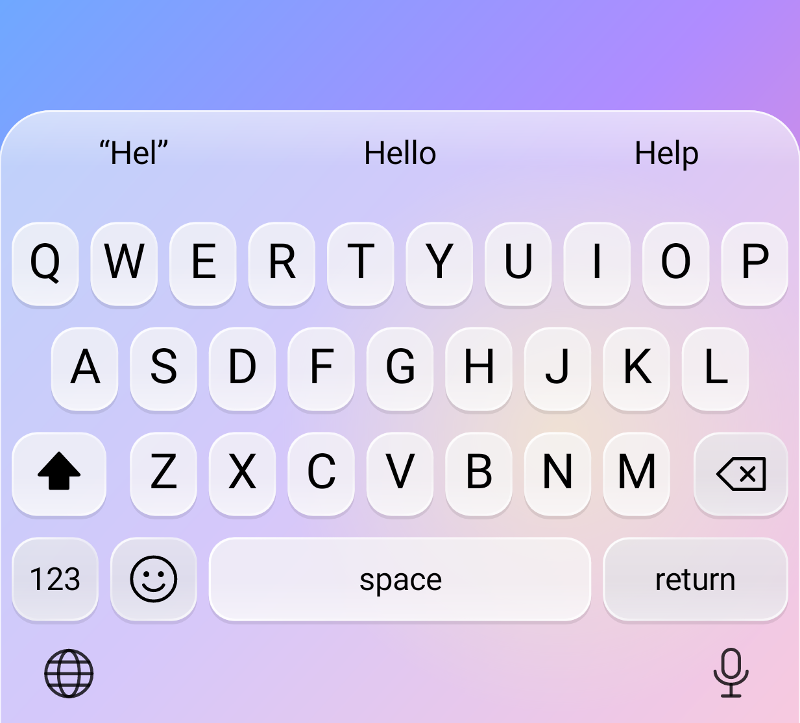
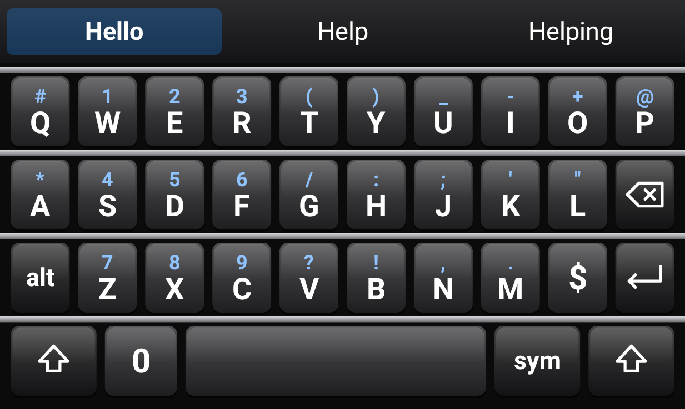
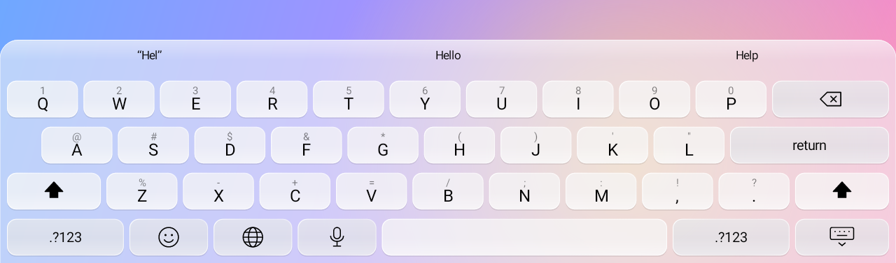

# MK Board — downloads

**iPhone-style (Liquid Glass) and BlackBerry-style keyboards for Android: phones, tablets and foldables.**

### ⬇️ [Download the latest APK](https://github.com/Mkuz1/MK-Board-releases/releases/latest)

## Install
1. Download `MKBoard-x.y.z.apk` from the latest release and open it on your phone (Android 9 or newer). Allow "install unknown apps" when asked.
2. Open **MK Board** → *Open keyboard settings* → turn on **MK Board · iPhone** and/or **MK Board · BlackBerry**.
3. *Switch keyboard…* → pick one.

## Updates
Once MK Board is installed, it checks this page for new versions and offers to install them. You'll get a notification; tap **Update now**. You can also check under *Updates* on the app's main screen.

> Coming from version 2.0 or older? Uninstall it once, then install 2.1.0. Later updates install in place.

## Privacy
Nothing you type ever leaves your device. The app only contacts GitHub to check this page for updates, and you can turn that off.

---
This repository only hosts releases. MK Board is not affiliated with Apple or BlackBerry.
